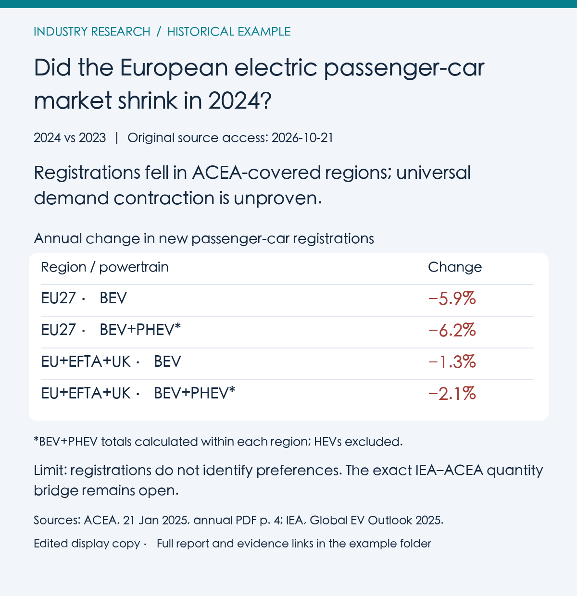
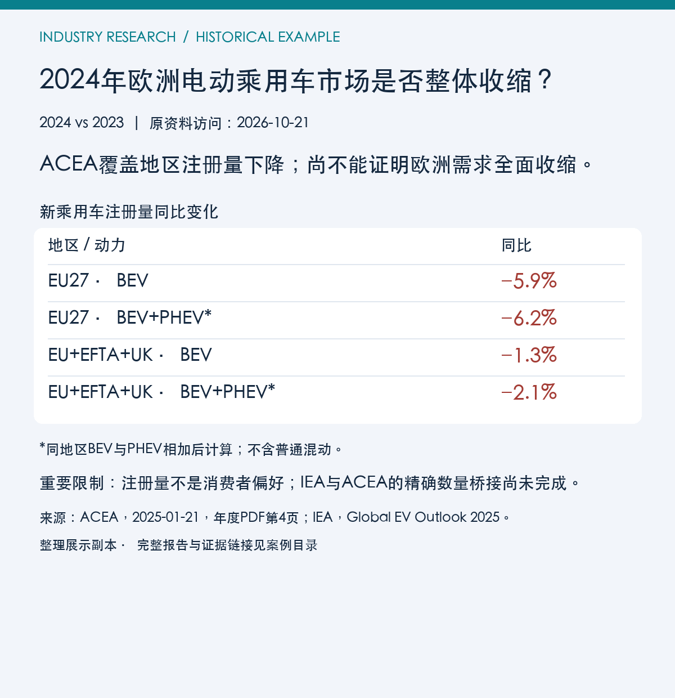

# Example · 2024 European electric passenger cars · 欧洲电动乘用车

Historical research: 2024 versus 2023; original source access **21 October 2026**. This public edition was prepared on 23 October 2026. It is an edited display copy and English translation of a completed Chinese trial, not the original run, a new English-runtime trial, or a current market assessment.

历史研究：2024全年对比2023全年；原资料访问日为 **2026年10月21日**，展示版整理日为2026年10月23日。这是已完成中文试用的整理展示副本及英文翻译，不是原始运行产物、新英文运行时试验或当前市场判断。

## Original task · 原始任务

> For a market team: based on public materials covering full-year 2024, did the European electric passenger-car market contract overall? Which demand conclusions are supported, and which cannot yet be drawn?

> 为行业市场团队回答：根据2024全年公开资料，欧洲电动乘用车市场是否出现了整体收缩？哪些关于需求变化的结论有依据，哪些还不能得出？

The original scope compared only 2024 with 2023, allowed source-specific geographic and powertrain definitions, and excluded forecasts and investment advice. It selected concise research, saved a G3 evidence checkpoint, and continued in a context without prior chat history to a bounded reader report. This describes saved records, not newly repeated historical tool actions.

原范围仅比较两个年度，按来源确定地域与动力分类，不预测、不提供投资建议；精简研究先保存G3证据检查点，再由无先前聊天历史的上下文接续到有边界的报告。这里描述保存记录，不声称本次重演历史工具动作。

## Read and reuse · 阅读与复用

1. Read the [English report](report.md) or [中文报告](report.zh-CN.md) for results and limits.
2. Inspect [research notes](research-notes.md) for source → evidence → claim links, conflicts and open gaps; [data.json](data.json) holds the selected annual inputs.
3. Copy the [resume prompt](resume-prompt.md) into a new session to inspect records and choose a next step.
4. Rebuild the static previews with `python3 render-previews.py` (Python 3 + Pillow; see the script for font options). No generative image model is used.

先读报告，再看[研究记录](research-notes.md)中的证据链、冲突和缺口；[接续提示](resume-prompt.md)说明新会话如何核对状态、所需工具和下一步。[数据](data.json)仅保存本例所需输入；预览由可复现脚本排版。

## Provenance and rights · 来源与许可

Prepared from the local trial's final report, checkpoint evidence/calculations, continuation record and offline review. Original test records, logs and private identifiers are excluded. The original offline review checked internal consistency and arithmetic, not every external source; the continuation's partial re-visits were not a full re-reading of annual tables. This public edition does not inherit historical PASS labels or approvals.

依据本地试用的最终报告、检查点证据与计算、接续记录和离线评阅整理；不公开原测试、日志及私人标识。原评阅核对内部一致性与算术，未独立重取每份来源；接续时的局部复访不等于完整重读年度表。本展示版不继承历史PASS或批准。

Original project-authored example text, translations, layout code and previews are covered by the repository's [MIT License](../../LICENSE). Third-party source materials retain their own rights: MIT does not grant redistribution rights to linked articles, tables, PDFs or other source content. Only links, locators and limited factual paraphrases are included; no third-party full texts or PDFs are bundled.

本项目自有示例文字、翻译、排版代码和预览适用仓库MIT许可；第三方来源保留其权利，MIT不授予其文章、表格、PDF等材料的再分发权。本例仅含链接、定位和有限事实转述，不打包原文。
